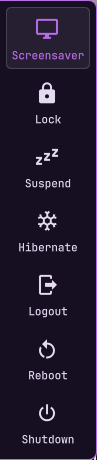

# System Drawer

Omarchy's System menu as a small drawer of icons that pulls out of the left
edge of the screen. Each entry is a glyph with its name underneath:
Screensaver, Lock, Suspend, Hibernate, Logout, Reboot and Shutdown.



It opens two ways, and both are always on:

- **Pointer** — rest the pointer on the middle of the left screen edge. The
  drawer slides out, and tucks away again shortly after the pointer leaves.
  A pointer thrown at the edge on its way somewhere else does not call it,
  and the edge stays quiet under a fullscreen window.
- **Key** — `omarchy-shell dan.system-drawer toggle`, bound to whatever combo
  you like. Opened this way the drawer takes the keyboard: arrows or `j`/`k`
  to move, `Enter` to run, `Escape` or a click elsewhere to dismiss. It also
  opens over a fullscreen window.

The entries run the same commands as the stock System menu and follow the same
rules: Suspend and Hibernate are left out where the machine cannot do them. As
in the stock menu, a click acts at once, with no confirmation.

## Install

```bash
omarchy plugin add https://github.com/WeaselBiggs/omarchy-system-drawer.git --enable
```

Or drop the folder into `~/.config/omarchy/plugins/dan.system-drawer/` and run
`omarchy plugin enable dan.system-drawer`. Needs Omarchy 4.5 and a Nerd Font
as the system font (the default).

Then bind a key in `~/.config/hypr/bindings.lua`. To take `SUPER + ESCAPE`
over from the stock System menu, which stays reachable from the Omarchy menu
and the power button:

```lua
hl.unbind("SUPER + ESCAPE")
o.bind("SUPER + ESCAPE", "System drawer", "omarchy-shell dan.system-drawer toggle")
```

## IPC

```bash
omarchy-shell dan.system-drawer toggle   # open on the focused screen, or close
omarchy-shell dan.system-drawer open
omarchy-shell dan.system-drawer close
omarchy-shell dan.system-drawer state    # JSON, for debugging
```

## Tuning

`SystemDrawer.qml` is the service: the list of actions, their glyphs and
commands, and the IPC. `DrawerWindow.qml` draws one screen's drawer; the
properties at its top set the tile size (`tileWidth`, `tileHeight`), how long
the pointer must rest on the edge (`dwell`, 120 ms) and how much of the edge
calls the drawer (`triggerLength`). Colours, corner rounding, fonts and
spacing come from the Omarchy theme, and the slide is skipped when animations
are turned off.

Labels are translated through `i18n/` (English and French so far); a missing
language falls back to English.

Edits to a service plugin are not picked up live: run `omarchy restart shell`
after changing the QML.

## Other Omarchy plugins

- [omarchy-dock](https://github.com/WeaselBiggs/omarchy-dock) — dock clone with a running mark under open apps
- [omarchy-vapour](https://github.com/WeaselBiggs/omarchy-vapour) — Steam playtime bar widget
- [omarchy-thunderclock](https://github.com/WeaselBiggs/omarchy-thunderclock) — clock with Thunderbird events
- [omarchy-thermals](https://github.com/WeaselBiggs/omarchy-thermals) — temperatures and fans

## Licence

MIT.
